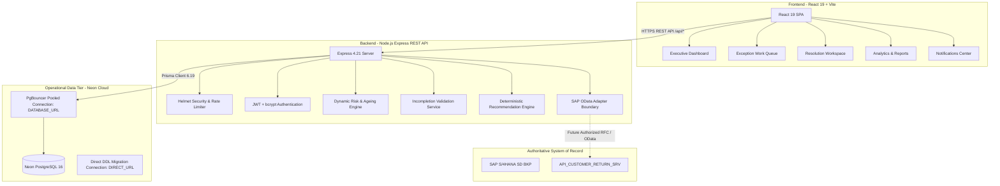

# SunGrid Renewables — Customer Return Exception Control
### SAP S/4HANA SD (BKP) Lead-to-Cash Returns Management
**PostgreSQL + Prisma ORM Production-Ready Upgrade**  
**Author:** Karthik Thalipineni  
**Evaluation Scope:** KAAR Technologies 2nd Round Assessment Rebuild  

---

## 1. Executive Summary & Business Problem

**SunGrid Renewables** is an India-based utility-scale renewable-energy enterprise producing solar modules and wind turbine nacelles:
- **Workforce:** ~7,600 employees
- **Manufacturing Plants:** Plant `1108` (Solar Module Fabrication), Plant `1102` (Wind Turbine Components)
- **Logistics:** 4 Regional Distribution Centres (`SL11` and `SL02` returns quarantine storage)
- **Annual Enterprise Revenue:** ~£2.1 Billion
- **Core ERP System of Record:** SAP S/4HANA Sales & Distribution (SD), supporting Customer Returns (Scope Item BKP).

### The Business Challenge
While SAP S/4HANA executes core accounting and logistics transactions, customer return exceptions frequently stall due to:
1. **SAP Incompletion Locks:** Omission of mandatory Return Reason codes or storage locations freezes automated document flows in `VA01`.
2. **Physical Count Variances:** Physical offloading at quarantine storage location `SL11` deviates from customer billed invoices.
3. **Approval Bottlenecks:** Refund requests exceeding £20,000 linger in ERP billing blocks (`08`).
4. **Accountability Gaps:** Ageing return exceptions accumulate unmonitored beyond 7-day SLA thresholds.

### Financial Stakes
- **1% to 2% of Annual Revenue at Risk:** Leadership estimates **£21M to £42M** is tied up or leaked through premature write-offs, disputed billing blocks, and expedited freight.
- **Target Outcomes:** Projected 20% to 35% productivity improvement and 10% to 20% cycle-time reduction in exception resolution.

---

## 2. Assessment Reference Case Spotlight: `INV-460008`

The application spotlights the exact assessment transaction:

| Dimension | Specification | Operational SAP Context |
| :--- | :--- | :--- |
| **Company Code** | `1300` | SunGrid Renewables Ltd |
| **Plant** | `1108` | Solar Module Fabrication Plant |
| **Storage Location** | `SL11` | Returns & Quality Quarantine Storage |
| **Cost Centre** | `CC-2208` | Customer Service & Warranty Absorption |
| **Material** | `Composite Panel CP-12` | High-efficiency photovoltaic module |
| **Document Ref** | `INV-460008` | Original billing reference (SAP Doc `60004128`) |
| **Amount** | `GBP 23,500` (`£23,500`) | Measured financial exposure (Decimal precision) |
| **Requested Date** | `2026-08-13` | Base date for dynamic millisecond ageing |
| **Processing Status** | `Partially Processed` | Incomplete document flow |
| **Business Partner** | `Meridian Stores` | Regional distributor |
| **Physical Discrepancy** | 10 vs 15 Units | Physical arrival at SL11 logged 10 units vs 15 on invoice. **Reconciliation saves £7,833.30 from over-crediting.** |

---

## 3. Technology Architecture



> **IMPORTANT ARCHITECTURAL NOTE:**  
> PostgreSQL is the application's operational workflow database. It is **NOT** a replacement for SAP S/4HANA. SAP remains the authoritative system of record for accounting ledgers, physical stock movements, and financial postings.

---

## 4. Key Upgrades in this Release

1. **Relational Database Migration:** Replaced flat-file JSON and in-memory arrays with **Neon PostgreSQL** via **Prisma ORM 6.19**.
2. **ACID Transaction Guarantees:** Multi-table writes (approvals, timeline events, audit entries, status mutations) execute atomically via `prisma.$transaction()`.
3. **Enterprise Security & Authentication:** Implemented JWT authentication, bcrypt password hashing (10 rounds), HTTP security headers (`helmet`), and auth rate limiting (`express-rate-limit`).
4. **Role-Based Access Control (RBAC):** Server-enforced permissions across 4 standard personas (`RETURNS_ANALYST`, `RETURNS_MANAGER`, `FINANCE_APPROVER`, `ADMIN`).
5. **Database-Persisted Notifications:** Notification read/unread states are written directly to PostgreSQL, persisting across sessions and device reloads.
6. **Unique Document Integrity:** Added unique constraints on `sapDocument` to prevent duplicate return document processing.
7. **Monetary Decimal Precision:** Migrated all currency amounts to PostgreSQL `Decimal(12, 2)` to eliminate floating-point rounding errors.

---

## 5. Local Setup Instructions (Windows PowerShell)

### Prerequisites
- Node.js `v18.0.0` or higher (`v22.19.0` tested)
- npm `v9.0.0` or higher

### Step 1: Clone & Configure Backend Environment
From the repository root:
```powershell
cd server
cp .env.example .env
```
Ensure `server/.env` contains your Neon connection strings:
```ini
DATABASE_URL="postgresql://neondb_owner:<password>@ep-lucky-bread-beiju9t3-pooler.c-9.us-east-2.aws.neon.tech/neondb?sslmode=require&channel_binding=require"
DIRECT_URL="postgresql://neondb_owner:<password>@ep-lucky-bread-beiju9t3.c-9.us-east-2.aws.neon.tech/neondb?sslmode=require&channel_binding=require"
JWT_SECRET="0053d275723bf8299523df716a220184cb9076f56b2cc17984e582ca7e5de768"
NODE_ENV="development"
PORT=5000
CLIENT_URL="http://localhost:5173"
```

### Step 2: Install Dependencies & Run Database Migration
```powershell
# Inside server directory:
npm install
npx prisma generate
npx prisma migrate dev --name init
npx prisma db seed
```

### Step 3: Run the Test Suite
Verify database connectivity, CRUD, duplicate prevention, and REST endpoints:
```powershell
npm test
```
*(All 13 automated test cases will execute and verify against Neon PostgreSQL).*

### Step 4: Run the Application
In two separate terminals:

**Terminal 1 (Backend API):**
```powershell
cd server
npm run dev
# Server running at http://localhost:5000
```

**Terminal 2 (Frontend React):**
```powershell
cd client
npm install
npm run dev
# Vite client running at http://localhost:5173
```

---

## 6. Seeded Demo Users & Personas

Default password for all demo accounts: `SunGrid@2026!`

| Email | Persona Name | Role | Primary Authority |
| :--- | :--- | :--- | :--- |
| `sundaram@sungrid.com` | **P. Sundaram** | `RETURNS_MANAGER` | Case assignment, triage, approve operational ($\le$ £25k) |
| `sharma@sungrid.com` | **A. Sharma** | `RETURNS_ANALYST` | Triage, inspect, propose recommendations, comment |
| `finance@sungrid.com` | **R. Nair** | `FINANCE_APPROVER` | Approve high-value returns (>£20k), credit memo release |
| `admin@sungrid.com` | **System Admin** | `ADMIN` | Full configuration, user management, demo reset |

---

## 7. Production Deployment Guide

### Deploying to Render (Backend Web Service)
- **Root Directory:** `server`
- **Build Command:** `npm install && npx prisma generate && npx prisma migrate deploy`
- **Start Command:** `npm start`
- **Environment Variables:** `DATABASE_URL`, `DIRECT_URL`, `JWT_SECRET`, `NODE_ENV=production`, `CLIENT_URL=https://<your-vercel-app>.vercel.app`
- **Health Check Path:** `/api/health`

### Deploying to Vercel (Frontend React SPA)
- **Root Directory:** `client`
- **Build Command:** `npm run build`
- **Output Directory:** `dist`
- **Environment Variable:** `VITE_API_BASE_URL=https://<your-render-backend-url>/api`

---

## 8. Complete Documentation Library

Detailed documentation artifacts are located in the [`docs/`](./docs) directory:

1. [Project Overview](./docs/PROJECT_OVERVIEW.md)
2. [Proposed Solution](./docs/PROPOSED_SOLUTION.md)
3. [Business Problem Analysis](./docs/BUSINESS_PROBLEM_ANALYSIS.md)
4. [Business Process Flow](./docs/BUSINESS_PROCESS_FLOW.md)
5. [System Architecture](./docs/SYSTEM_ARCHITECTURE.md)
6. [Database Design & Schema](./docs/DATABASE_DESIGN.md)
7. [SAP S/4HANA Integration Strategy](./docs/SAP_INTEGRATION_STRATEGY.md)
8. [REST API Documentation](./docs/API_DOCUMENTATION.md)
9. [Business Rules & Risk Methodology](./docs/BUSINESS_RULES.md)
10. [Security & Deployment Architecture](./docs/SECURITY_AND_DEPLOYMENT.md)
11. [Automated Testing Report & Verification](./docs/TESTING_REPORT.md)
12. [Limitations & Future Scope](./docs/LIMITATIONS_AND_FUTURE_SCOPE.md)
13. [Technical Interview Defense Guide](./docs/INTERVIEW_PREPARATION.md)
14. [3-Minute Assessment Demonstration Script](./docs/DEMONSTRATION_SCRIPT.md)

---

## 9. Verification Summary & Test Results

```
================================================================
                      TEST EXECUTION SUMMARY                    
================================================================
Total Test Cases Executed: 13
Passed:                   13
Failed:                   0
Overall Status:           ALL TESTS PASSED (100%)
================================================================
```
- **Neon Cloud Connectivity:** Verified on port 5432.
- **Relational Integrity:** Verified foreign key cascading on `ReturnComment` and `ReturnEvent`.
- **Duplicate Prevention:** Verified `P2002` rejection on duplicate `INV-460008`.
- **Process Lifecycle Persistence:** Verified that records created in one process persist and remain retrievable in subsequent independent processes.
