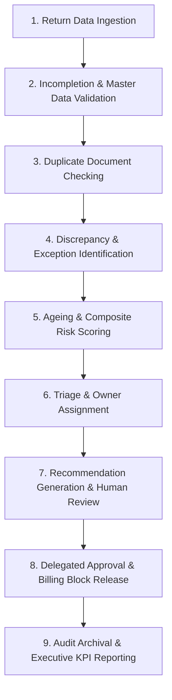

# Business Process Flow: Lead-to-Cash Customer Returns (SAP SD BKP)

**Author:** Karthik Thalipineni  
**Scope Alignment:** SAP S/4HANA SD BKP Standard Scope  

---

## 1. End-to-End Exception Lifecycle

The operational lifecycle transitions through 9 distinct stages, ensuring full human governance, auditability, and ERP consistency:

---

## 2. Detailed Process Stage Specifications

### Stage 1: Return Data Ingestion
- Inbound customer return requests originate from customer portals, EDI 812 messages, or internal RMA generation.
- Records flow into the SunGrid Exception Control layer via authenticated REST endpoints and are persisted in Neon PostgreSQL.

### Stage 2: Incompletion & Master Data Validation
- The `validationService` runs automated completeness checks against SunGrid's master data matrix:
  - Verifies Company Code is `1300`.
  - Maps Plant `1108` or `1102` to allowed Storage Locations (`SL11` / `SL02`).
  - Verifies Cost Center (`CC-2208` / `CC-1102`).
  - Flags missing SAP SD mandatory incompletion fields (e.g. Return Reason Code).

### Stage 3: Duplicate Document Checking
- The system enforces a unique database constraint on `sapDocument` (`INV-460008`).
- Prevents duplicate claims, fraudulent double-credits, and redundant case files from being created across different operational shifts.

### Stage 4: Discrepancy & Exception Identification
- Compares inbound logistics goods receipts (`VL01N` Post Goods Receipt document) with billed customer invoices.
- Identifies volume variances (e.g. 10 physical units received vs 15 units invoiced on `INV-460008`).

### Stage 5: Ageing & Composite Risk Scoring
- Calculates exact days elapsed from `requestedDate` to the current wall-clock timestamp.
- Evaluates risk against 4 transparent dimensions:
  1. Overdue SLA status (>7 days review target).
  2. Financial exposure tier ($<$£10k, £10k–£20k, $>$£20k).
  3. Execution mismatch (goods receipt count $\neq$ order count).
  4. Missing mandatory incompletion attributes.
- Assigns composite score (0–100) and risk tier (`LOW`, `MEDIUM`, `HIGH`, `CRITICAL`).

### Stage 6: Triage & Owner Assignment
- Cases with `Unassigned` status trigger high-severity notifications in `Notification`.
- Returns Managers assign accountable case owners (Returns Analyst or Finance Approver) with mandatory justification logging in `AuditLog`.

### Stage 7: Recommendation Generation & Human Review
- The deterministic recommendation engine evaluates transaction parameters and generates clear, actionable advice.
- For `INV-460008`, it suggests adjusting order quantity to 10 units, assigning Reason Code `015`, and releasing the billing block.
- Operators review the recommendation in the **Resolution Workspace** and choose to:
  - **Accept:** Adopts recommended actions verbatim.
  - **Edit:** Modifies resolution quantities or reason codes, recording an audit explanation.
  - **Reject:** Dismisses suggestion with recorded operator feedback.

### Stage 8: Delegated Approval & Billing Block Release
- If total return exposure exceeds £20,000, multi-tiered RBAC requires **Finance Approver** sign-off.
- Upon approval:
  - Return status updates to `Completed`.
  - Billing block is cleared (`None`).
  - Credit memo reference is assigned (`CR-907800`).
  - Milestone event is written to `ReturnEvent` and `Approval`.

### Stage 9: Audit Archival & Executive Reporting
- Every state transition, comment, re-assignment, and decision writes an immutable log to `AuditLog`.
- `ExecutiveDashboard` and `AnalyticsReports` refresh real-time KPIs: active backlog, overdue ageing buckets, SLA compliance rates, and total exposure at risk.
