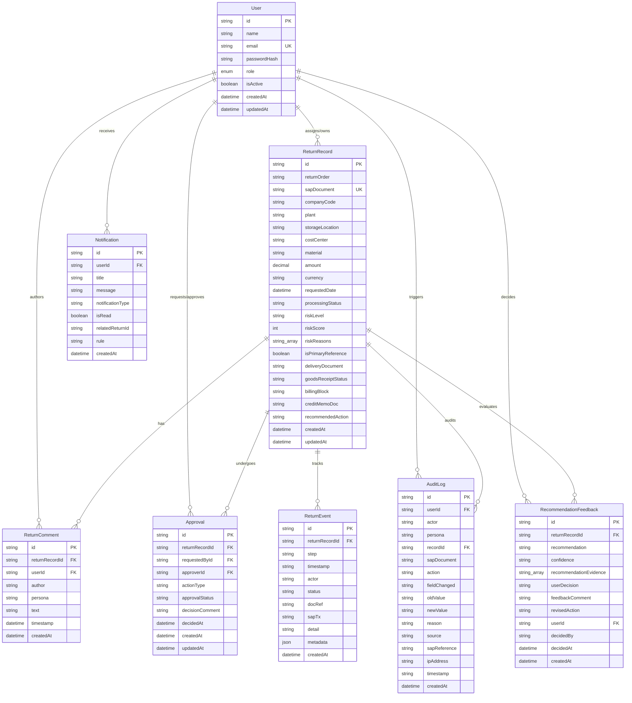

# Database Design: Relational Schema & Models (PostgreSQL + Prisma)

**Author:** Karthik Thalipineni  
**Database Engine:** Neon-hosted PostgreSQL  
**ORM:** Prisma 6.19.3  

---

## 1. Entity Relationship Diagram (ERD)

---

## 2. Table Specifications & Design Decisions

### Model 1: `User`
- **Purpose:** Manages operator identities, credentials, and role-based access control.
- **Key Columns:**
  - `id`: String UUID Primary Key.
  - `email`: Unique index; used for authentication login.
  - `passwordHash`: Bcrypt hash (10 salt rounds); plain-text passwords are never stored.
  - `role`: Enum (`RETURNS_ANALYST`, `RETURNS_MANAGER`, `FINANCE_APPROVER`, `ADMIN`).
  - `isActive`: Boolean flag supporting soft deactivation.

### Model 2: `ReturnRecord`
- **Purpose:** Stores the operational return cases mirroring SAP SD BKP structures.
- **Key Columns & Design Choices:**
  - `id`: String Primary Key (preserves existing human-readable IDs such as `RET-2026-001`).
  - `sapDocument`: String with **Unique Constraint** (`INV-460008`) preventing duplicate document processing.
  - `amount`: **`Decimal(12, 2)`** instead of floating-point to guarantee absolute financial accuracy without rounding errors.
  - `currency`: String default `GBP`; prevents mixed currency contamination.
  - `riskReasons`: Native PostgreSQL text array (`text[]`) storing multi-factor risk drivers.
  - Indexes: B-tree indexes placed on `sapDocument`, `plant`, `processingStatus`, `riskLevel`, and `assignedOwnerId` for rapid work-queue filtering.

### Model 3: `ReturnComment`
- **Purpose:** Internal operational collaboration thread between Analysts, Managers, and Finance.
- **Foreign Key:** `returnRecordId` references `ReturnRecord.id` with `onDelete: Cascade`.

### Model 4: `Approval`
- **Purpose:** Tracks governance approval requests and decisions.
- **Key Columns:** `actionType` (`APPROVE`, `REJECT`, `REQUEST_APPROVAL`), `approvalStatus` (`PENDING`, `APPROVED`, `REJECTED`), `decisionComment`, and `decidedAt`.

### Model 5: `ReturnEvent` (Timeline)
- **Purpose:** Complete document flow milestone history (e.g., `VA01` Order Created -> `VL01N` Delivery -> `SL11` Receipt -> `VF01` Credit Memo).
- **Foreign Key:** `returnRecordId` with cascade delete.

### Model 6: `AuditLog`
- **Purpose:** Immutable compliance trace recording every state mutation, user action, justification reason, and SAP reference document ID.
- **Indexes:** Indexed on `recordId`, `sapDocument`, `action`, and `persona`.

### Model 7: `Notification`
- **Purpose:** In-app operational alerts and SLA breach warnings.
- **Key Feature:** **Database-persisted `isRead` flag**, ensuring that marking alerts as read persists across browser sessions and device reloads.

### Model 8: `RecommendationFeedback`
- **Purpose:** Records human decisions on system recommendations (`ACCEPTED`, `EDITED`, `REJECTED`) along with supporting evidence and revised actions.
