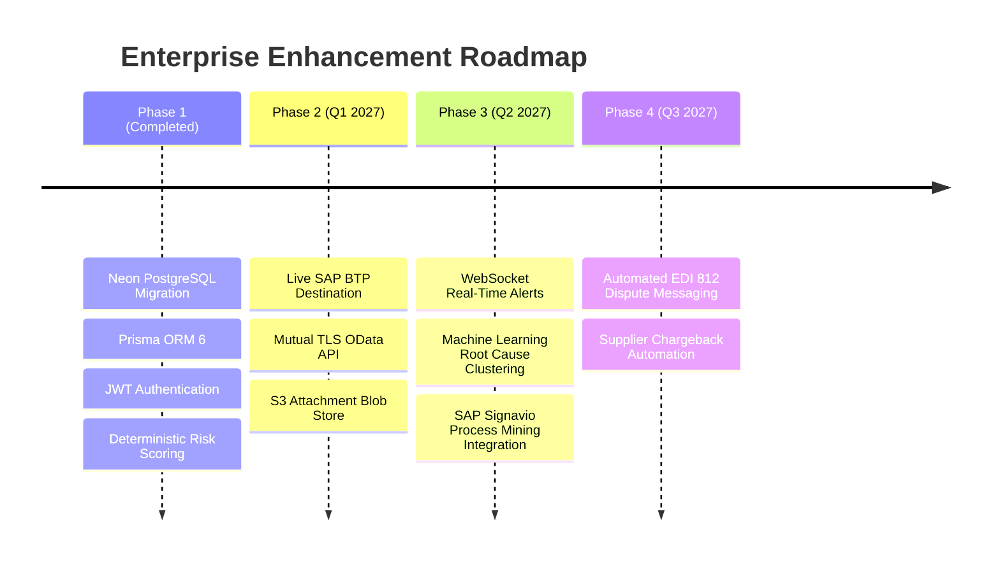

# Limitations & Future Scope: SunGrid Exception Control

**Author:** Karthik Thalipineni  
**Enterprise Context:** SunGrid Renewables  

---

## 1. Current Implementation Limitations

To maintain enterprise integrity and technical accuracy, the following boundaries of the current implementation are explicitly acknowledged:

1. **Simulated SAP Gateway (Demo Mode):**  
   The application features a fully articulated SAP OData adapter with entity mapping, configurable latency, and error simulation. However, it does not currently transmit actual RFC packets to an active SAP S/4HANA application server.
2. **Deterministic Rather Than Machine Learning Recommendations:**  
   The recommendation engine uses deterministic business rules based on invoice vs goods receipt count variance. It does not connect to an external generative AI or LLM model.
3. **Local File Attachments in Workspace:**  
   Document uploads in the Resolution Workspace are held in browser state for demonstration purposes rather than being committed to an enterprise blob store (e.g. AWS S3 or Azure Blob Storage).
4. **Synchronous Notification Polling:**  
   Notifications are retrieved via REST on component mount rather than a bidirectional WebSocket or Server-Sent Events (SSE) connection.

---

## 2. Future Scope Roadmap

### Future Enhancement Details:
1. **Live SAP BTP Connectivity:** Replace the mock adapter with an authenticated SAP Cloud Foundry Destination using Client Credentials grant and RFC connection pooling.
2. **Cloud Document Repository:** Integrate AWS S3 / Azure Blob Storage with pre-signed URLs to store physical inspection photographs and carrier bills of lading.
3. **Machine Learning Anomaly Detection:** Train unsupervised clustering models on historical quality quarantine data (`SL11`) to identify supplier-specific batch defects before customer delivery.
4. **Automated Supplier Chargebacks:** Automatically generate debit memos against component suppliers when physical inspection reveals manufacturing micro-cracks (such as defect batch `B-882` on Composite Panel CP-12).

