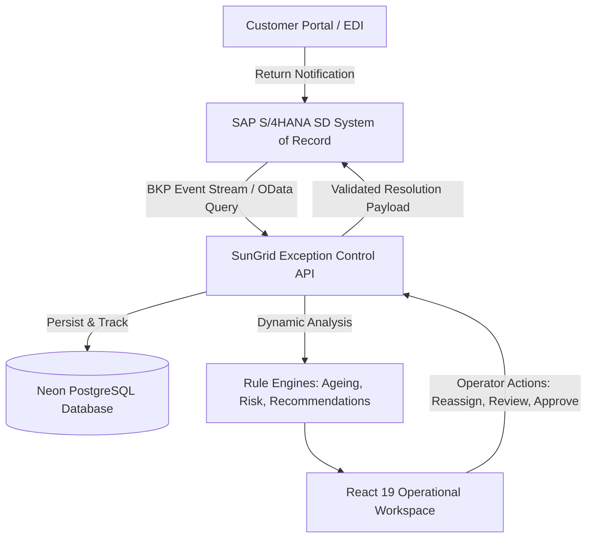

# Proposed Solution: SunGrid Customer Return Exception Control

**Author:** Karthik Thalipineni  
**Enterprise Context:** SunGrid Renewables  
**Core Domain:** Lead-to-Cash / Customer Returns Management (SAP S/4HANA SD BKP)

---

## 1. Architectural Philosophy: Coexistence, Not Replacement

The proposed solution operates on a strict enterprise design principle:

> **PostgreSQL and this application are NOT a replacement for SAP S/4HANA.**  
> SAP S/4HANA is the authoritative system of record for accounting ledgers, inventory valuation, physical stock movements, and customer billing. This application serves as an **operational orchestration and decision-support layer** designed to streamline exception triage, prioritize backlog, and prepare validated actions before posting back to SAP.

---

## 2. Solution Components

### Component 1: Centralized Operational Data Store (Neon PostgreSQL + Prisma)
- Eliminates siloed departmental spreadsheets and ephemeral memory caches.
- Centralizes returns master data, transaction status, multi-role comments, approval workflow history, timeline milestones, and notifications into a normalized relational schema.
- Uses Prisma ORM to guarantee foreign key integrity, cascade deletions where appropriate, and unique document indexing.

### Component 2: SAP Incompletion & Data Quality Engine
- Evaluates inbound return records against SAP SD BKP organizational unit rules:
  - Validates Company Code `1300`.
  - Verifies Plant logistics mapping: Plant `1108` (Solar) vs Plant `1102` (Wind).
  - Enforces mandatory physical Storage Location assignments: `SL11` (Solar Quality Quarantine) or `SL02` (Wind Finished Goods).
  - Enforces Cost Center warranty absorption: `CC-2208` or `CC-1102`.
  - Ensures Return Reason codes comply with SAP SD catalog tables.

### Component 3: Explainable Dynamic Risk Engine
- Rather than static integers, computes case ageing dynamically in real time from `requestedDate` using millisecond arithmetic.
- Assigns composite risk scores (0–100) and tiers (`LOW`, `MEDIUM`, `HIGH`, `CRITICAL`) using weighted parameters:
  - Overdue SLA breach (>7 days): **+35 pts**
  - High financial exposure (>£20,000 threshold): **+25 pts**
  - Goods receipt vs invoice execution variance: **+25 pts**
  - Missing mandatory incompletion fields: **+20 pts**

### Component 4: Deterministic Decision Support & Recommendation Engine
- Automatically parses discrepancies between the original customer invoice (`INV-460008`) and the physical warehouse goods receipt delivery (`80004128` at `SL11`).
- Generates transparent, verifiable recommendations (e.g., adjust billing quantity from 15 to 10 units, assign Return Reason `015 - Solar Panel Cell Fracture`, and release billing block `08`).
- Allows human operators to accept, edit with rationale, or reject suggestions, persisting all decisions in `RecommendationFeedback` and `AuditLog`.

### Component 5: Role-Based Approval & Governance Matrix
- Enforces strict delegated authority limits:
  - **Returns Analysts:** Case inspection, data validation, internal notes, recommendation proposal.
  - **Returns Managers:** Case triage, owner assignment, operational sign-off for exposures $\le$ £25,000.
  - **Finance Approvers:** Mandatory sign-off for credit memo releases and exposures $>$ £20,000.
  - **Administrators:** User management, SAP adapter configuration, database maintenance.

---

## 3. Projected Business Target Outcomes

| Target Metric | Baseline Manual Process | Projected Target | Business Rationale |
| :--- | :--- | :--- | :--- |
| **Exception Triage Throughput** | Fragmented across emails & VA01/VL01N | **20% to 35% productivity improvement** | Single-screen workspace replaces multi-t-code navigation. |
| **Average Case Cycle Time** | 18–24 days | **10% to 20% reduction in ageing** | Automated overdue alerts and SLA escalation prior to breach. |
| **Financial Leakage Prevention** | Disputed over-credits issued | **Immediate savings (£7,833.30 on INV-460008)** | Automatic matching of warehouse receipt counts vs invoice counts. |

*Note: All improvement percentages represent projected operational targets requiring post-implementation verification.*

