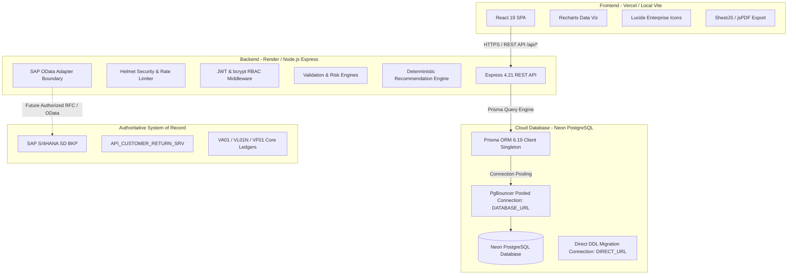

# System Architecture: SunGrid Customer Return Exception Control

**Author:** Karthik Thalipineni  
**Architecture Classification:** 3-Tier Enterprise Web Application with Cloud Database & ERP Boundary  

---

## 1. High-Level Technical Architecture

---

## 2. Component Details

### A. Frontend Tier (React 19 + Vite)
- **Framework:** React 19.3.1 with Vite fast build tooling.
- **Styling:** Custom Enterprise CSS Design System inspired by SAP Fiori Horizon (Navy `#0f172a`, Crisp Slate `#f8fafc`, SAP Blue `#0284c7`, semantic status pills).
- **State Management:** Reactive hooks with centralized data loading and error handling.
- **Reporting:** Client-side SheetJS (`xlsx`) for Excel reports and jsPDF for printable audit summaries.
- **Port:** Local `http://localhost:5173` (proxied to `:5000` via `vite.config.js`).

### B. Backend API Tier (Node.js + Express)
- **Framework:** Node.js v22 with Express v4.21 (native ES Modules).
- **Security:**
  - `helmet`: Sets `Cross-Origin-Resource-Policy` and HTTP security headers.
  - `cors`: Restricts origins to approved domains (`CLIENT_URL`).
  - `express-rate-limit`: Prevents credential brute-forcing on `/api/auth/login`.
- **Authentication:** Stateless JSON Web Tokens (JWT) signed with 256-bit secret, verified via middleware.
- **Transactions:** Multi-table writes (such as Approvals updating Return status, adding timeline milestones, and appending audit entries) execute atomically within `prisma.$transaction([...])`.
- **Port:** Local `http://localhost:5000` (configurable via `PORT` environment variable).

### C. Database Tier (Neon PostgreSQL + Prisma ORM)
- **Database Engine:** PostgreSQL 16 hosted on Neon Serverless Cloud.
- **Connection Architecture:**
  - **Runtime Traffic (`DATABASE_URL`):** Connects through Neon's PgBouncer pooler (`ep-...-pooler...`) to prevent connection exhaustion during concurrent traffic.
  - **DDL Migrations (`DIRECT_URL`):** Connects directly to PostgreSQL application server (`ep-...`) to support PostgreSQL session locks and migration schema generation.
- **Prisma Client Singleton:** Prevents duplicate Prisma Client instantiations across Express request lifecycles.

### D. ERP Boundary Tier (SAP S/4HANA SD)
- **Service Name:** `/sap/opu/odata/sap/API_CUSTOMER_RETURN_SRV`
- **Current Mode:** Explicitly documented **Demo Mode** (`isDemoMode: true`).
- **Simulated Latency:** Artificial 350ms delay to emulate wide-area corporate network latency.
- **Error Injection:** Configurable simulation toggle in Settings to demonstrate application retry resilience and error handling when SAP Gateway returns HTTP 503 RFC timeouts.
